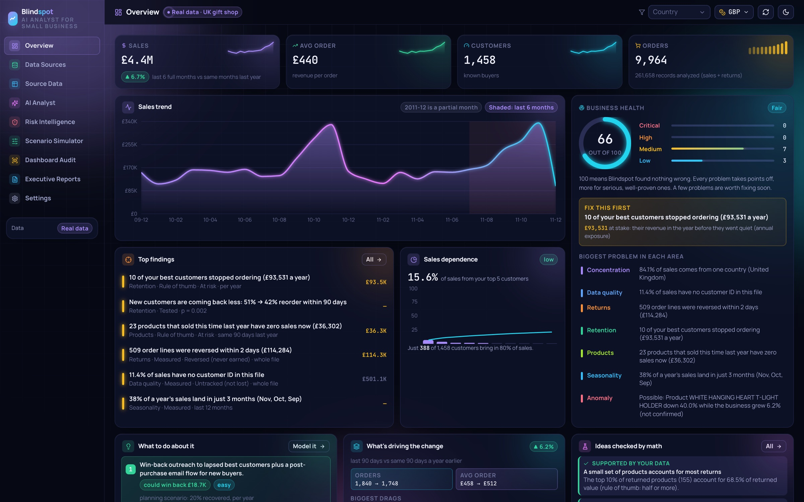
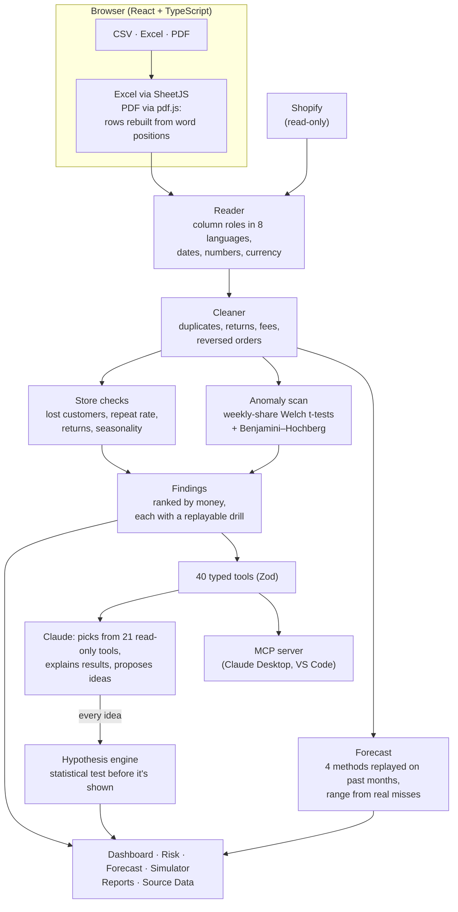

# Blindspot

> **Work in progress, not part of any hackathon submission.** This branch holds features built *after* the
> submissions were made. Judges: please evaluate the submitted version on the `main` branch and the live site.

[](https://github.com/Sidd-solves/BlindSpot/actions/workflows/ci.yml)     [](LICENSE)

**The AI analyst for small businesses. See what your sales data is hiding.**

Live: **https://blindspot-8lr1.onrender.com** · Fact check: [docs/FACT_CHECK.md](docs/FACT_CHECK.md)

[](https://blindspot-8lr1.onrender.com)

Small business owners make big decisions on gut feeling, because analysts and BI tools are built for big companies. Blindspot connects to a **Shopify store** or a **CSV / Excel file** and, in seconds:

- **Cleans** the data: duplicates, returns, fees, orders reversed within 2 days, sales with no customer
- **Finds** what's costing money: customer dependence, loss-making products, returns, lost best customers, products that stopped selling, shrinking orders, seasonality
- **Scans the rest**: each sizeable product and country compared with the business as a whole, year over year, testing weekly revenue share and adjusting for many comparisons
- **Tests ideas**: business hypotheses (built-in or proposed by AI) labeled supported, not supported, small effect or not enough evidence, with the one-sided p-value each verdict was decided on
- **Predicts**: next months' sales with a replayed track record, customers worth checking on (the warning is replayed on past data), unusual sales gaps that may be stock-outs, and seasonal sales dips
- **Checks beliefs**: "was it the promo?" (season-controlled, compared with every other start date, and never claiming cause) and a fact-check for any claim about two groups or this year vs last
- **Traces every finding**: each finding replays on the raw rows and matches to the penny, and a 3-bar meter shows how sure each number is
- **Plans the fix**: what each problem costs, what fixing it could be worth (labeled estimates), a roadmap and a one-page report

Every number comes from deterministic code. The AI (Claude) explains results and suggests ideas; the code checks them.

## Tested on real data
UCI **Online Retail II**: a real UK online gift shop, 1,067,371 sales lines (Dec 2009 – Dec 2011), CC BY 4.0. Blindspot found, among others: a best-selling product down 51% while the shop grew 5%, 42 best customers who stopped ordering (£301K a year), new customers coming back less (49% → 40%), 1,978 orders reversed within 2 days, and 34,335 duplicate lines. **Seven headline numbers were recomputed by independent Python code; all match** ([docs/FACT_CHECK.md](docs/FACT_CHECK.md)). The live demo runs on a 25% customer sample whose trend matches the full data.

## How it works

Every number comes from deterministic code. The model never calculates; it calls tools, and the tools do the math.

| Folder | What's in it |
|---|---|
| [`apps/web`](apps/web/src) | React 18, Vite, Tailwind, Framer Motion, Recharts: the showcase site and the app (Overview, Data Sources, Source Data, AI Analyst, Risk, Simulator, Audit, Reports) |
| [`services/api`](services/api/src) | Express server: [routes](services/api/src/routes), private per-visitor [sessions](services/api/src/sessions.ts), Shopify, [Claude tool loop](services/api/src/llm.ts) |
| [`packages/analytics`](packages/analytics/src) | The engine: [file reader](packages/analytics/src/ingest), [cleaning](packages/analytics/src/retail.ts), [statistics](packages/analytics/src/stats.ts), [store checks](packages/analytics/src/insights.ts), [findings](packages/analytics/src/findings.ts), [hypotheses](packages/analytics/src/hypotheses.ts), [forecast](packages/analytics/src/forecast.ts), [scenarios](packages/analytics/src/scenario.ts), [reports](packages/analytics/src/report.ts) |
| [`packages/tool-contracts`](packages/tool-contracts/src) | 40 Zod-validated tools, [guardrails](packages/tool-contracts/src/guardrails.ts), session state |
| [`services/mcp-server`](services/mcp-server/src) | The same 40 tools over the Model Context Protocol |

## Hard problems we solved
1. **PDFs don't contain tables.** A PDF stores words at x/y positions. [`pdfLayout.ts`](apps/web/src/lib/pdfLayout.ts#L102) groups words into printed lines, merges lines that wrapped inside one row (using the gap between rows), finds the header row and sets column edges halfway between headings, so right-aligned numbers land in the right column. Tested with real PDFs printed by Chrome, including cells that wrap, and a 68-page sample report.
2. **Every store exports different columns.** [`detectRoles`](packages/analytics/src/ingest/columns.ts#L527) scores each column twice: by its name in eight languages, including non-Latin scripts ([`NATIVE`](packages/analytics/src/ingest/columns.ts#L465)), and by its values ([`fits`](packages/analytics/src/ingest/columns.ts#L490): dates, money, emails, IDs). Known platform layouts (Shopify, WooCommerce, Etsy, Amazon, Square, Stripe) are recognized first, and month-per-column crosstabs (e.g. from Tableau) are unpivoted. The person sees how every column was read and can fix any of them in one click.
3. **Holiday rushes and luck can fake a problem.** [`scanAnomalies`](packages/analytics/src/insights.ts#L168) compares each product's and country's *share* of weekly revenue with the same weeks a year earlier. Weeks are the unit of evidence, so many lines from one order don't count as independent proof. It uses a one-sided [Welch t-test](packages/analytics/src/stats.ts#L130) with [Benjamini–Hochberg](packages/analytics/src/stats.ts#L228) correction across everything scanned. Signals that don't survive the correction are shown as "not confirmed".
4. **"Trust me" isn't good enough.** Every finding stores how it was calculated (which values, row type and date windows). [`/api/rows`](services/api/src/routes/rows.ts#L95) replays that on the raw rows and adds it up in integer pennies, so the check matches the finding **to the penny**, not "within 0.1%".
5. **The AI must not make up numbers.** In the [chat loop](services/api/src/llm.ts#L127), Claude can only call [21 read-only tools](services/api/src/llm.ts#L29), checked against an allow-list on every call. Uploaded text is treated as untrusted and [screened](packages/tool-contracts/src/guardrails.ts#L33), and secrets are [redacted](packages/tool-contracts/src/guardrails.ts#L74) from logs. When Claude proposes an idea, [`testGeneric`](packages/analytics/src/hypotheses.ts#L127) turns it into a statistical test, and it's labeled supported, not supported or not enough evidence *before* anyone sees it.
6. **Real data is messy.** In the UCI file, an 80,995-unit order (£168K) was placed and canceled the same day. [`prepareTransactions`](packages/analytics/src/retail.ts#L99) pairs a sale with its exact reversal (same customer, product, quantity and price within two days) and removes both, because that money was never real. It also removes exact duplicate lines and sets aside fees and postage.
7. **A forecast has to prove itself first.** [`forecastSales`](packages/analytics/src/forecast.ts#L182) replays four simple methods on each of the last 12 months, using only the months before it. The method is chosen at every one of those months from its errors *so far*, so the accuracy shown (about 9% average miss on the UK shop) belongs to the whole process, not to a winner picked with hindsight. The 80% range comes from real past misses (Student-t × their root-mean-square), and the page shows how many past months actually landed inside it. A [test](tests/forecast.test.ts) proves that changing a later month never changes an earlier forecast.
8. **A warning has to beat chance on past data.** [`earlyWarning`](packages/analytics/src/customers.ts#L150) flags customers worth checking on. The obvious rule, "late for their own usual reorder gap", was tested first and **failed**: on the real shop, flagged customers came back as often as everyone else. Plain silence (45–90 days) held up on a tuning date and again on a later validation date: 42% of flagged customers stayed away vs 24% of the rest (p < 0.001). Most flagged customers still came back, so the page presents a list to check on first, not a prediction that each will leave, and it only claims the warning works when the test on *your* data is significant.
9. **A stock-out leaves a footprint, not a record.** Without stock levels, [`stockOuts`](packages/analytics/src/operations.ts#L83) looks for a regular product's longest run of 5–60 *trading* days with no orders (shop closures don't count). It counts distinct **orders**, not lines, and skips any product with order numbers on under 95% of its own sales (and says how many). The gap gets a **heuristic score**: the Poisson-style chance of that silence at the product's usual rate, slowed by its burstiness, scaled for searching the whole history, then adjusted across products. It is *not* presented as a p-value. Its behaviour is measured on held-out simulated shops ([`scripts/gap-eval.ts`](scripts/gap-eval.ts)), separate from the ones used to tune it: **1 false flag in 1,530** product histories, and a 25-day gap caught 6/6 in steady, declining and overdispersed sellers but 0/6 in bursty or strongly seasonal ones. Both numbers are shown on the page. Shown as "unusual sales gaps, cause unknown".
10. **"Did my promo work?" is usually answered wrong.** [`eventImpact`](packages/analytics/src/impact.ts#L86) compares weekly sales with the same weeks a year earlier and tests before vs after on those ratios. It also runs the same comparison at every other start date and reports how many showed a shift as big, as context rather than a false-alarm rate. Verdicts say "sales rose after the change", never "it worked": a before/after comparison can't rule out other things that changed at the same time.
11. **Reading a dashboard's colors from a screenshot.** [`paletteFromPixels`](packages/analytics/src/color.ts#L197) bins the pixels, takes the most common as the background, keeps saturated colors, and merges anti-aliased edges by testing whether a color is a blend of a chart color and the background, all in the browser.
12. **A free 512 MB server.** The case study is pre-cleaned at build time ([`build-case-study.ts`](scripts/build-case-study.ts)), uploads are capped per request, and the server [pings itself](services/api/src/uptime.ts) so the free plan never puts it to sleep.

Design decisions and their trade-offs: [docs/DESIGN.md](docs/DESIGN.md).

## Run it
Needs **Node.js 22+** and npm.
```bash
git clone https://github.com/Sidd-solves/BlindSpot.git && cd BlindSpot
npm install
npm run dev     # API on :8787, web on :5173 (open http://localhost:5173)
npm test        # 244 tests: statistics, file reading (incl. real PDFs), analytics, forecasting, customers, stock-outs, all 40 tools, sessions, API + MCP
npm run typecheck  # strict TypeScript, 0 errors
npm run format:check
npm run lint       # ESLint, 0 problems
npm run coverage   # 82% of lines in the engine, tools and API
npm run bench      # speed test: 1M real rows read + cleaned in ~40 s, analyzed in ~6 s (2020 Intel i5 laptop)
```
Add `ANTHROPIC_API_KEY=` to `.env` for Claude answers (optional; without it the analyst answers common questions with real queries). Try it with the sample files in `apps/web/public/samples/` (a 68-page PDF report and a CSV), or the **Try a 68-page PDF sales report** button on the start page. Production: see [docs/DEPLOYMENT.md](docs/DEPLOYMENT.md).

## Credits
- **Dataset:** Chen, D. (2012). *Online Retail II* [Dataset]. UCI Machine Learning Repository. https://doi.org/10.24432/C5CG6D (CC BY 4.0). The Harbor Coffee and Willow & Wick sample reports are synthetic files made for testing.
- **Libraries:** React, Vite, Tailwind CSS, Framer Motion, Recharts, lucide-react (icons), pdf.js (`pdfjs-dist`), SheetJS (`xlsx`), Papa Parse, Express, express-rate-limit, cors, ws, Zod, the Anthropic SDK, the Model Context Protocol SDK, Vitest, tsx. Font: Manrope (Google Fonts). Exchange rates: European Central Bank via frankfurter.dev.
- **AI:** Claude (Anthropic, Sonnet 5.5 by default) powers the in-app analyst. Claude Code was used as a coding assistant while building the project; all design decisions, testing and verification were done by the author.
- **Pre-existing work:** none. The project was started on 30 October 2026 (see the commit history); everything else is the open-source libraries listed above.

## Docs
[Feature matrix and limitations](docs/FEATURE_MATRIX.md) · [Fact check](docs/FACT_CHECK.md) · [Deployment](docs/DEPLOYMENT.md) · [Slides](docs/slides/BlindSpot_slides.pdf)
